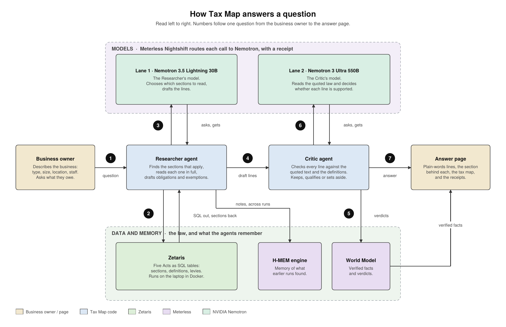

# Tax Map

Tax Map is for the owner of a small Nigerian business, starting with Lagos, who wants to know which taxes and levies apply to them and which authority collects each one. They describe the business (type, sector, local government, size, staff, premises, signage) and ask what they owe. Tax Map reads the statutes, drafts a list of obligations and exemptions, checks every line against the quoted law, and shows the result as a map of who collects what, with the exact section behind each line. The design rule is that **the statute text is the source of truth; the model is the reader; the code enforces it.** A model chooses what to read and drafts the lines, but nothing reaches the page unless the code has confirmed that the model read the section, that its quote is in the text, and that the claim fits the business.

## Problem

Nigeria's tax law changed in 2025: four new Acts replaced much of the old framework, and the allocation of who collects what between the federal government, the States and the local governments still sits in a 1998 Act. A shop owner in Ikeja has no practical way to read 454 sections of new law, find the few that apply, and work out whether VAT returns, PAYE, a Tax ID or a signboard permit are theirs to deal with, or whether the Nigeria Revenue Service, the Lagos State Internal Revenue Service or the local government is the one to pay. A language model on its own would answer fluently and sometimes wrongly, and a wrong tax answer costs the owner penalties. Tax Map makes the answer checkable: every line cites a section the owner can open, and a second model, the Critic, has to quote that section back before the line is shown.

## How it works



1. **Question in.** The business owner describes the business and asks what they owe. The page sends the profile and question to the Researcher.
2. **SQL out, sections back.** The Researcher queries the statutes in Zetaris with SQL: it browses a Part, searches, reads sections in full, or lists the 1998 levy Schedule. Zetaris returns the rows. The Researcher also keeps notes in the H-MEM engine, which carry across runs.
3. **The Researcher asks Lane 1.** Each Researcher turn is a call through Meterless Nightshift to Nemotron 3.5 Lightning 30B, which chooses the sections to read and drafts the lines.
4. **Draft lines to the Critic.** The Researcher hands over claims, each with the sections it cites and a plain-words line.
5. **Verdicts to the World Model.** For each claim the Critic's verdict, reason and quote are recorded as a fact in the World Model, together with the section text it rests on.
6. **The Critic asks Lane 2.** The Critic sends each claim, the section text and the defined terms to Nemotron 3 Ultra 550B through Nightshift and asks whether the text supports the claim for this business.
7. **Checked answer to the page.** The page shows the lines that survived with plain-words versions, the section behind each, the tax map by collecting authority and the model-call receipts. Lines the Critic set aside are listed separately.

### What the code enforces

- **Read before cite.** A claim keeps a citation only if the Researcher read that section in full with `get_sections` (or `list_levies`) in this run. Citations to anything it only saw in a search snippet are fetched and rechecked, or dropped. A claim left with no citation is removed and the removal is recorded in the notes.
- **Verified quotes.** The Critic must quote the deciding text. The code checks that the quote appears verbatim in the section (one excerpt, or two to four fragments joined by " … " in document order). A "supported" or "qualified" verdict whose quote is not found is changed to "struck".
- **Definitions attached by code.** The code parses each Act's interpretation section into a glossary and attaches the definitions of the terms a claim and its sections use (for example "small business", "taxable person") to the Critic's input. The model does not have to remember to look them up.
- **Claims-only coverage checklist.** The Researcher's draft must address six areas: registration and tax ID; tax on business profits; PAYE (if the business has employees); VAT; records and returns; levies. Only claims count towards coverage. An entry in "unanswered" never satisfies an area. Up to four targeted turns are spent on areas with no claim.
- **Plain-words check.** Each claim has a one-sentence second-person line. The Critic model checks that it says nothing the legal sentence does not. If it does, the model's fix replaces it. If the check cannot run, the page shows the legal sentence alone.
- **Levy relevance filter.** The 1998 Schedule lists levies for every kind of business. After the draft, the code keeps one claim per Schedule item, requires each levy claim to name a fact about the business (premises, signage, sector, employees or turnover), and caps levy claims at six. The Critic strikes a levy whose subject does not fit the profile. Amounts from the Schedule are never asserted: a claim that states one is struck without a model call.
- **Collector placement by NTAA s. 3.** Which authority collects a line is decided by code, from Nigeria Tax Administration Act s. 3 (the Nigeria Revenue Service for companies, VAT and the development levy; the State's tax authority for resident individuals) and, for levies, from the Schedule Part that lists the item (Part I federal, Part II State, Part III local government). The Schedule rule outranks the keyword rules.

## Setup

**Prerequisites**

- Node.js 20 or later (`engines.node` is `>=20`).
- Docker, with the Zetaris platform running locally. The statutes are served from Zetaris.
- Meterless Nightshift reachable locally (default `http://127.0.0.1:8088/v1`), with an NVIDIA key behind it and two lanes: one for the Researcher (Nemotron 3.5 Lightning 30B, app `taxmap`) and one for the Critic (Nemotron 3 Ultra 550B, app `taxmap-critic`).
- For re-parsing the statutes only: Python 3 with `pdfplumber`, and the source PDFs (not stored in this repo; see SOURCES.md). The parsed JSON in `data/statutes/` is committed, so this is not needed to run the app.

**Environment.** Copy `.env.example` to `.env` and fill in:

| Key | Purpose |
| --- | --- |
| `PORT` | Port the server listens on (8080). |
| `METERLESS_BASE_URL` | Nightshift's OpenAI-compatible endpoint. |
| `METERLESS_RUNTIME_TOKEN` | Token for Nightshift. Never logged. |
| `METERLESS_APP` | App (lane) name for the Researcher's calls (`taxmap`). |
| `METERLESS_MODEL` | Researcher model: `nvidia/nemotron-3.5-lightning-30b-a3b`. |
| `METERLESS_CRITIC_MODEL` | Critic model: `nvidia/nemotron-3-ultra-550b-a55b`. |
| `ZETARIS_REST_URL` | Zetaris REST API (`http://localhost:8888/api/v1.0`). |
| `ZETARIS_ORG_ID` | Zetaris organisation id. |
| `ZETARIS_API_KEY` | Zetaris API key. Never logged. |
| `SAMPLE_MODE` | `true` replays the recorded run and needs no keys; `false` runs live. |
| `CRITIC_PIECE_CHARS` | Longest piece of section text per Critic call (6000). |
| `CRITIC_DIRECT_NVIDIA`, `NVIDIA_API_KEY` | Off-by-default fallback that sends a failed Critic call straight to NVIDIA. Leave empty. |

**Register the statutes in Zetaris.** The statute tables are REST tables over the JSON files in `data/statutes/`, read from raw GitHub URLs pinned to a commit. Push the JSON, then:

```bash
STATUTE_COMMIT=<commit sha that holds data/statutes/levies.json> npx tsx scripts/register_tables.ts
```

This creates the `TAXMAP_REST` database, the `taxmap` container, the `sections`, `acts` and `levies` views, and caches them. It skips what exists. `--dry-run` prints the statements without sending them, `--reset` drops the views and database and recreates them at the commit given (use it to move existing tables to a new commit), and `--cache-only` re-warms the caches. Without `STATUTE_COMMIT`, `taxmap.levies` is not created.

**Cache warm-up.** An uncached query over the REST tables re-fetches and re-parses the JSON each time, about 40 s, against about 0.4 s once cached. The Zetaris cache does not survive a container restart, so the server and the scripts warm it on start. If Zetaris is not up yet the server logs the failure and keeps running.

**npm scripts**

| Command | What it does |
| --- | --- |
| `npm run dev` | Start the server with `tsx` (live or sample mode per `.env`). |
| `npm run build` | Type-check and compile to `dist/` (`tsc`, strict). |
| `npm start` | Run the compiled server. |
| `npm test` | Run the vitest suite. |
| `npm run lint` | ESLint on `src`. |
| `npm run conformance` | Run only the H-MEM and World Model conformance suites. |

## Usage

**Sample mode** needs no keys, Zetaris or Nightshift:

```bash
SAMPLE_MODE=true npm run dev
```

Open http://localhost:8080 and press the button. The page replays a recorded live run event by event and says so at the top of the progress log ("Sample run: replaying an answer recorded on …"). See [Sample mode](#sample-mode).

**Live mode** needs Zetaris and Nightshift running and the tables registered:

```bash
npm run dev
```

A live run takes minutes. The Researcher has a 12-turn budget, up to four targeted coverage turns and one read-before-cite revision. The Critic makes about one call per cited section plus a plain-words check per claim.

**CLI scripts** (all live, all need `.env`):

| Script | What it does |
| --- | --- |
| `npx tsx scripts/run_researcher.ts ["question"]` | Researcher only, on the sample profile. |
| `npx tsx scripts/run_pipeline.ts ["question"]` | Researcher then Critic, printed. |
| `npx tsx scripts/record_sample.ts [options]` | Record a live run as the sample (see [Sample mode](#sample-mode)). |
| `npx tsx scripts/recheck_plain.ts [path.json]` | Re-run the plain-words check on a recorded sample without re-recording it. |
| `npx tsx scripts/smoke_meterless.ts` | Two live calls through Nightshift, plain and with a tool. |
| `npx tsx scripts/register_tables.ts` | Register the statutes in Zetaris (see Setup). |
| `python scripts/parse_acts.py` | Re-parse the five PDFs into `data/statutes/` (hash-checked). |
| `npm run conformance` | H-MEM and World Model conformance. |

**What the page shows.** A form for the business profile (the State is fixed at Lagos), then a plain-language progress log while the agents work. The result has a summary line, **Your tax map** (three columns: Federal, Lagos State and the owner's LGA, each naming the authority that collects its lines, with "Being added" under a tier that has no claims), then one card per line: the plain-words line, the legal sentence, a verdict label (Applies to you, Applies with a condition, Not verified), the Critic's reason with its quote, "Collected by", and a link that opens the section or Schedule item in a drawer. Lines the Critic set aside are listed in their own section, followed by anything the data could not answer and any notes. A closed "See how this answer was produced" section holds the run log, memory and World Model counts, queries, sections read, definitions, and every model call with its receipt.

## Agent roles

**Researcher.** Finds the sections that create obligations or exemptions for the profile and drafts claims tied to them. It works in a loop of up to 12 turns on Nemotron 3.5 Lightning 30B (Lane 1), starting from a map of the Acts built from the parsed sections. Its tools are `browse_part` (list the sections in one Part), `run_sql` (one read-only SELECT over `taxmap.sections` or `taxmap.acts`, 40 rows at most), `get_sections` (full verbatim text of up to 10 sections or Schedule items) and `list_levies` (the 1998 Schedule items one tier may collect). It reads and writes H-MEM notes across runs. It drafts claims (obligation or exemption), each with a legal sentence, a plain-words line, cited sections and the authority the text names. The agent code, not the model, drops any citation the model did not read, and applies the coverage and levy rules above.

**Critic.** Judges every claim against the quoted text only, with no tools. For each cited section it sends the profile, the claim, the definitions the code attached and the section text (split into pieces if long) to Nemotron 3 Ultra 550B (Lane 2) at temperature 0, and gets back a verdict (supported, qualified or struck), a reason and a verbatim quote that the code verifies. It strikes a claim the text does not establish, one the text disapplies for the profile (for example a small-business exemption), and a levy whose subject does not fit the business. After the verdict it runs one short plain-words check per claim. It never adds claims. Verdicts are written to the World Model.

## AI and Model Usage

**Product inference.** Every model call in the running product goes through **Meterless Nightshift 1.2.3**, pinned to a lane, and returns a signed-receipt envelope:

- **Researcher: NVIDIA Nemotron 3.5 Lightning 30B** (`nvidia/nemotron-3.5-lightning-30b-a3b`).
- **Critic: NVIDIA Nemotron 3 Ultra 550B** (`nvidia/nemotron-3-ultra-550b-a55b`), including the plain-words check.

Each call records its requested and routed model, provider, tier, tokens, latency and receipt id. The page shows these under "Model calls".

**Development.** The code was written in **Claude Code (Anthropic)**, used in the Claude Desktop app, and in **Cursor** for edits. Planning and prompt drafting were done with Claude. The human author reviewed every file and ran every test.

**What is and is not generated.**
- No outputs are hardcoded. Every claim, verdict, quote and plain-words line on the page was produced by a model call in a live run and then checked by code.
- Sample mode replays a recorded live run. It is labelled as a replay on the page and in the progress log, and makes no model or Zetaris calls.
- The direct NVIDIA route (`CRITIC_DIRECT_NVIDIA`) exists only as an off-by-default fallback for failed Critic calls. It was not used in any recording: every receipt in the recorded sample shows the Nightshift route.

## Sponsor technology

**Zetaris.** The five Acts are served from Zetaris, and the Researcher queries them with SQL. Each JSON file in `data/statutes/` is a Lightning REST table over its pinned GitHub raw URL, exposed through schema-store views (`taxmap.sections`, `taxmap.acts`, `taxmap.levies`). Because the REST tables re-fetch and re-parse the JSON on every uncached query, the views are cached with `CACHE TABLE`: a query that took about 40 s uncached took about 0.4 s cached, which is what makes a twelve-turn research loop usable. The server and scripts re-warm the cache on start, because it does not survive a container restart. The SQL forms came from the Zetaris getting-started repo.

**Meterless.** Nightshift 1.2.3 is the primary AI provider: all product calls go through it and each carries a signed receipt. The two engines are implemented from the Meterless specs: **H-MEM** (tiered memory: store, retrieval, trust ledger, promotion; conformance 7/7) carries the Researcher's notes across runs, and the **World Model** (store, ingest, context builder; conformance 8/8) holds the Critic's verified facts and verdicts and serves each claim's context to the page. Counts come from `npm run conformance`, whose suites are derived from the specs' implementation checklists; the items outside the minimum build are listed by that command and not counted. Three Nightshift problems were reported to Meterless in the hackathon's Meterless channel; the first two are fixed in 1.2.3.

1. **Model-id routing (0.6.2, fixed in 1.2.3).** A request naming a specific model id was treated as `meterless/auto`, and the learned router chose the lane itself (receipt reason "uncertain-explore"), so a request for the 120B model was often answered by the 30B. Meterless confirmed and fixed it. Since the upgrade, every receipt's routed model has matched the requested model, including all 44 receipts in the recorded sample.
2. **Long-input failures (0.6.2, fixed in 1.2.3).** Chat completions carrying a full statute section (about 6 KB) failed with HTTP 502 after 45 s on both lanes, while a 600-character cut of the same text succeeded. Meterless traced it to a 45 s cloud first-token timeout and added a configurable "Cloud first-token limit" in 1.2.3. Tax Map runs it at 120 s, and the Critic's own timeout is 150 s.
3. **Reasoning budget slider (1.2.3, reported).** When the slider is set, Nightshift sends `thinking_token_budget` to every cloud lane. NVIDIA's Nemotron 3 Ultra 550B endpoint rejects it with a 400 ("not yet supported by the V2 model runner"), which reaches the app as a 502, so every Critic call failed until the slider was returned to its default. This was reported with a reproduction, and a per-lane setting was suggested.

Separately, a drafting call that exhausts its token cap mid-reasoning answers HTTP 502 `…_empty_response`, so the Researcher's drafting calls get 8,000 tokens and one retry at 16,000.

**Cursor.** Used for edits during development. The organisers removed the Cursor requirement on 22 October.

**NVIDIA.** Both agents run on Nemotron so the two roles share a model family but not a size: the Researcher needs a fast model that chooses tools and drafts, which Nemotron 3.5 Lightning 30B is, and the Critic needs the strongest reader in the stack to judge a claim against law, which Nemotron 3 Ultra 550B is. The receipts show what ran: in the recorded sample, all 44 calls were routed to the model that was requested (15 Researcher calls on Nemotron 3.5 Lightning 30B, tier A; 29 Critic calls on Nemotron 3 Ultra 550B, tier C), through provider `nvidia`, and all 44 receipts carry a signature envelope. The app records that envelope but does not itself verify the signature.

## Data sources

| act_id | Act | Copy used | SHA-256 |
| --- | --- | --- | --- |
| `NTA-2025` | Nigeria Tax Act, 2025 (202 sections) | FGP gazette, `NTA-2025-gazette-fgp.pdf` | `41ABF6887BC58A3C97116FD9A048AA91AD49C1CAB156F39065A58401C0FCE94F` |
| `NTAA-2025` | Nigeria Tax Administration Act, 2025 (148 sections) | Gazette, `NTAA-2025-gazette-gng.pdf` | `1602CF3245F250107E9BA0099C8755B52D04CD8A497A3C029772C624AB2C2625` |
| `NRSEA-2025` | Nigeria Revenue Service (Establishment) Act, 2025 (43 sections) | CTC copy (`acts/ctc`), `NRSA-2025-ctc.pdf` | `B7072257F6D68DD99EC10F332FBDDB5FB507681B85172852A16510BFAFB87F0E` |
| `JRBEA-2025` | Joint Revenue Board of Nigeria (Establishment) Act, 2025 (61 sections) | CTC copy (`acts/ctc`), `JRBA-2025-ctc.pdf` | `97B648230DEE2F6FC1E9F5248343DFB8D6C6D17B4C2D38ABE661ABEE6201E458` |
| `TLA-1998` | Taxes and Levies (Approved List for Collection) Act, 1998, Cap. T2 (5 sections, Schedule of 39 items) | `Nigeria_8_NigeriaTaxesLevies1998.pdf` | `F2693F35B511672AF30BDE5F10680726C221DD55B07270EF932E00AE28053E3E` |

That is 459 sections in total, parsed by `scripts/parse_acts.py` after checking each file against its folder's `hashes.txt`. The PDFs are not in the repo. SOURCES.md lists them with their folders.

**Two copies of the Nigeria Tax Act differ.** The LIRS copy (`NTA-2025-gazette-lirs.pdf`, SHA-256 `F15EDD3BC428D03FDDBAC7DAE9D5C7025C161BC02A04E42E3123975553965B91`) has 203 sections, including an extra s89 "Petroleum royalty" that the Federal Government Printer (FGP) copy lacks, which shifts every later section number by one. Some heading wording differs too. Tax Map cites the **FGP** copy (202 sections, matching its own table of contents).

**The Taxes and Levies Act is still in force.** None of the four 2025 Acts repeals it: the repeal provisions (Nigeria Tax Act s. 195 and s. 196; Nigeria Tax Administration Act s. 146) were checked and do not list it. Tax Map uses the **1998 Schedule only**: the 2015 Amendment Order was set aside by a Federal High Court judgment in 2020, so nothing from it is included. The Act says which tier may collect each item (Part I federal, 8 items; Part II State, 11 items; Part III local government, 20 items). Tax Map says only that an authority "may collect" a named levy. **It never asserts a rate or amount from this Act**: the Part II figures are 1998 maxima and State law may have replaced them. The item text, figures included, is still shown when the law is opened, so the owner can read it.

## Sample mode

**What is recorded.** `data/samples/retail-sole-proprietor-ikeja.json` holds one live run for a sole-proprietor retail shop in Ikeja (3 employees, premises, signage, turnover under ₦25 million, fixed assets under ₦250 million), asked "What taxes and levies does my business have to pay?". It has the full event trace (95 events), the draft, the checked claims with their plain-words lines, the definitions, the queries and sections read, the memory and World Model counts, and the receipts (model, lane tier, provider, receipt id, tokens, signed flag; signatures and keys are never stored).

**The current sample** was recorded on 24 October 2026 (17:10 UTC): 9 claims (7 supported, 2 set aside by the Critic, 0 qualified, 0 not verified), 44 model calls, 182,717 tokens in and 30,565 out, 44 of 44 receipts signed. **It was recorded before the 1998 levies Act was added**, so it holds no levy claims and the tax map's local government column shows "Being added" in sample mode. Re-record to include them.

**How it is recorded.** `scripts/record_sample.ts` runs the live pipeline up to `--attempts` times and keeps the attempt with the most supported claims among those that meet the limits:

```bash
npx tsx scripts/record_sample.ts --attempts 3 --min-claims 5 --min-supported 3 --max-claims 14 --fallback-min-claims 4
```

`--fallback-min-claims N` keeps the best attempt with at least N claims if none reaches `--min-claims`, and says so in its output. If no attempt qualifies, nothing is written and the existing sample stays. `--out path.json` writes a candidate elsewhere to compare first. `scripts/recheck_plain.ts` redoes only the plain-words checks on a recorded file. In sample mode the server replays the events at a short delay (`SAMPLE_DELAY_MS`), describes them with the current wording, and gives sample claims the collector placement the live rules would.

## Known limitations

- **Coverage is federal law plus the 1998 allocation.** The Lagos State Harmonised Taxes and Levies Law is not loaded, so State and local levy amounts, and which State levies apply, are not answered. The page says a State or local levy "may be collected", never how much.
- **Schedules of the 2025 Acts are excluded.** Each Act's text stops at its first Schedule. Rate tables and similar are not loaded; only the 1998 Act's Schedule is.
- **Residence is assumed to equal the business State.** The profile has one State, fixed at Lagos, and an individual is placed with the State tax authority on that basis (NTAA s. 3(2)).
- **The Researcher varies from run to run.** Recorded outputs for this profile ranged from 0 to 37 claims. Before the levy relevance filter, one recording drafted 37 claims, mostly every Part III item. After it, seven completed recorder attempts drafted 0 to 4 claims (0, 3, 2, 1, 4, 0 and 4), and the last recording run kept a 4-claim attempt under the fallback; two other attempts in that run failed on gateway errors. The committed sample has 9. A thin draft leaves checklist areas listed as unanswered.
- **Nightshift and model availability.** Live attempts took from under a minute to about fourteen. The gateway sometimes answers HTTP 502 `…_empty_response` or times out; calls are retried a bounded number of times, and a failed Critic call leaves a claim "Not verified" rather than rejected. Router and model availability on the day decides whether a live run completes.
- **The sample predates the levies source** (see [Sample mode](#sample-mode)).
- **This is not legal advice.** Tax Map shows what the loaded Acts say about a described business. It does not replace a tax adviser or the relevant authority.

## Pre-existing components

- The Zetaris getting-started repository was read for the SQL forms and API shapes. Nothing was copied from it.
- The Meterless H-MEM and World Model engine specs are the design source. The engines were implemented from scratch for this project.
- Everything else was written during the hackathon.

## Tests

```bash
npm test
npm run conformance
```

`npm test` runs the whole vitest suite: **232 tests in 22 files, all passing**. `npm run conformance` runs only the conformance suites and prints **H-MEM conformance 7/7, World Model conformance 8/8**. These suites are derived from the Implementation Checklists of the Meterless engine specs; items outside the minimum build are listed by the command and are not counted. `npm run build` (strict TypeScript) and `npm run lint` pass.
